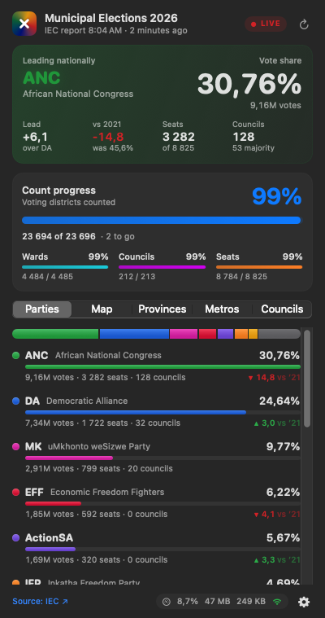
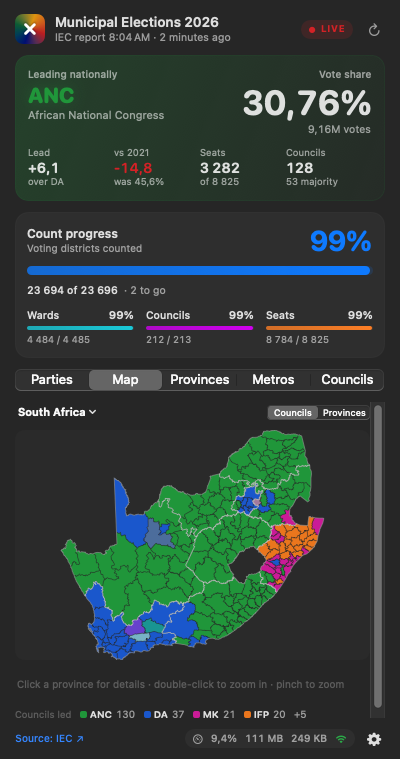

# SA Elections Tally

A tiny macOS menu bar app that tells you who's winning South Africa's 2026 municipal elections,
because refreshing the IEC website every five minutes is no way to live.

<p>
  
  
</p>

## What it does

- **Menu bar:** shows the leading party and its share (`● ANC 31,9%`). You can switch it to the lead margin or the top two parties.
- **Click it** to open a dashboard:
  - the national split and swing since 2021
  - count progress
  - provinces, metros and councils
  - a map you can drill into: **country → province → municipality → ward → individual voting station**
- **Lightweight:** about 0% CPU when closed, and at most about 30 KB a minute while the count is on.
- **Offline:** if your Wi-Fi dies it keeps showing the last saved results.
- **Uninstall:** it removes itself without leaving crumbs behind.

## Install

You need macOS 14 or later and the Xcode command line tools.

```bash
./scripts/install.sh
```

To uninstall, either click ⚙️ → **Uninstall Tally…** in the app, or run `./scripts/uninstall.sh`.

## Where the numbers come from

The IEC has no public API, so Tally reads the same JSON files that the
[IEC results dashboard](https://results.elections.org.za/dashboards/lge/) uses. It's unofficial, so if the
numbers actually matter to you, check the IEC.

The map boundaries are simplified from the IEC's own boundary files.

For the nerdy details (endpoints, caching, failsafes, the 17.5 MB Johannesburg file),
see [docs/technical-notes.md](docs/technical-notes.md).

## Licence

[WTFPL](LICENSE). Do what the fuck you want with it.

That covers the code. The election results and boundary data belong to the IEC, so they're not mine to licence.
